<div align="center">

# ✦ Stellar Conquer

**Explora el ecosistema Stellar, comercia en su DEX y conquista la Frontera.**

Un universo 3D donde cada estrella es un proyecto real de Stellar, con una economía en Soroban y
partidas de estrategia en tiempo real.

[**Jugar ahora**](https://stellar-conquer.vercel.app) ·
[Contratos en testnet](#contratos-desplegados-en-testnet) ·
[Funciones y comprobantes](#funciones-y-comprobantes) ·
[Assets](#assets)

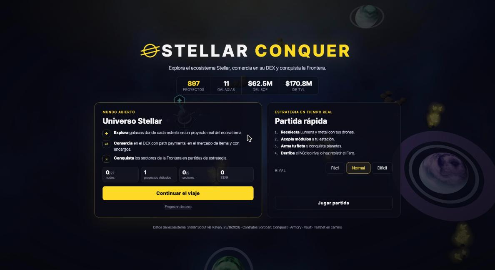

</div>

## Qué es

Stellar Conquer tiene dos capas que comparten una misma economía:

| | Universo Stellar | La Frontera |
|---|---|---|
| **Género** | Mundo abierto y exploración | Estrategia en tiempo real (RTS) |
| **Qué haces** | Pilotas una nave entre 11 galaxias, descubres proyectos reales del ecosistema, cambias en el DEX y compras en el mercado | Recolectas, acoplas módulos a tu estación, armas tu flota y derribas el Núcleo rival |
| **On-chain** | Ítems y mercado (**Armory**), recursos que se negocian en el DEX nativo | Resultados verificables y recompensas en STAR (**Conquest**), liquidación de recursos (**Vault**) |

Lo que lo hace distinto:

- **Ecosistema real.** Los 897 proyectos activos de Stellar, con su financiación del SCF, su TVL y sus
  auditorías, vienen de Stellar Scout, la misma fuente que usa Raven. `pnpm snapshot` los refresca.
- **La red hace el trabajo pesado.** STAR y los recursos son activos clásicos de Stellar: se negocian en el
  DEX y los pools AMM nativos y se ven en cualquier wallet. Solo hay tres contratos Soroban.
- **Resultados verificables.** La partida es determinista. Un verificador la vuelve a simular y firma el
  resultado con ed25519, y cualquiera puede impugnarlo durante la ventana de disputa.

## El universo

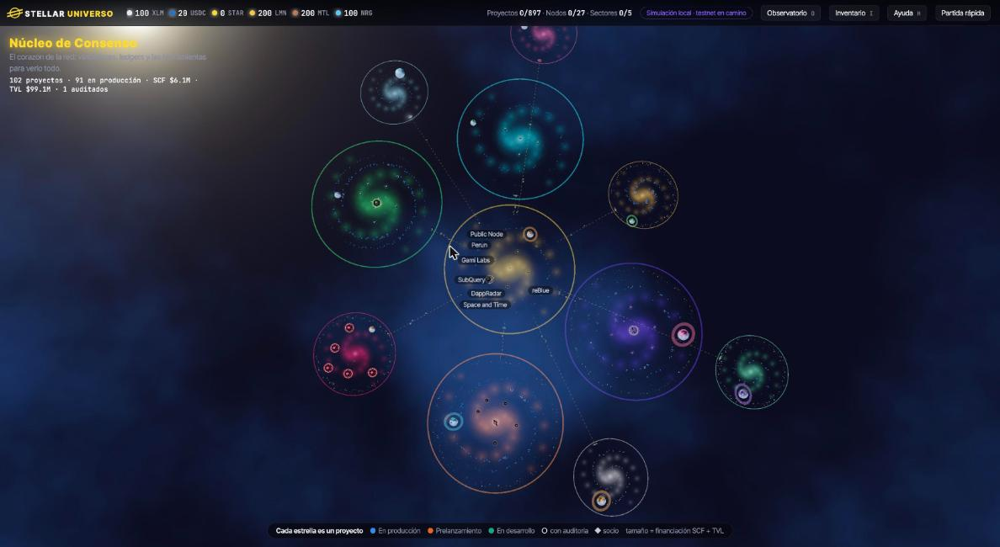

El Núcleo de Consenso está en el centro, y una ruta comercial con una puerta de salto lo une con cada
galaxia. Por las rutas circulan cargueros, y entre los nodos de cada galaxia viajan lanzaderas.

**Cómo leer el mapa:**

- **Estrellas.** Cada una es un proyecto. El color indica su estado (azul, en producción; naranja,
  prelanzamiento; verde, en desarrollo), el tamaño crece con su financiación del SCF y su TVL, y un anillo
  blanco marca que tiene auditoría.
- **Diamantes.** Son los socios del ecosistema: anclas, rampas, infraestructura y auditores.
- **Construcciones.** Cada nodo es una estructura que dice qué hace:
  - el DEX es una estación de anillo giratorio;
  - el mercado, un bazar orbital con contenedores;
  - el comercio, un puerto de carga;
  - el Observatorio, un radiotelescopio;
  - cada sector de la Frontera, una ciudadela con escudo.

### Las 11 galaxias

Cifras de la instantánea del 25 de noviembre de 2026.

| | Galaxia | Qué hay | Datos |
|---|---|---|---|
| 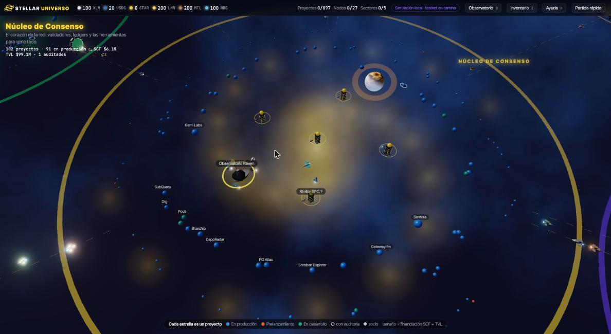 | **Núcleo de Consenso** | Validadores, ledgers, RPC, exploradores y el Observatorio Raven | 102 proyectos · SCF $6,1M · TVL $99,1M |
| 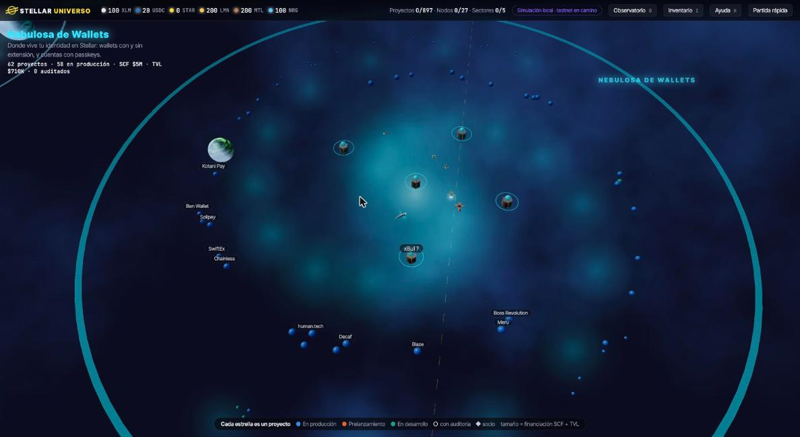 | **Nebulosa de Wallets** | Freighter, LOBSTR, xBull, Beans y cuentas con passkeys | 62 proyectos · SCF $5M · TVL $710K |
| 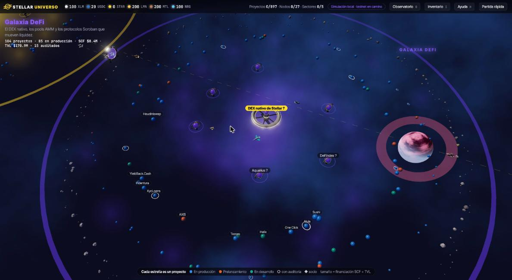 | **Galaxia DeFi** | El DEX nativo, Soroswap, Aquarius, Phoenix, Blend, DeFindex y Reflector | 104 proyectos · SCF $8,4M · TVL $170,9M · 15 auditados |
| 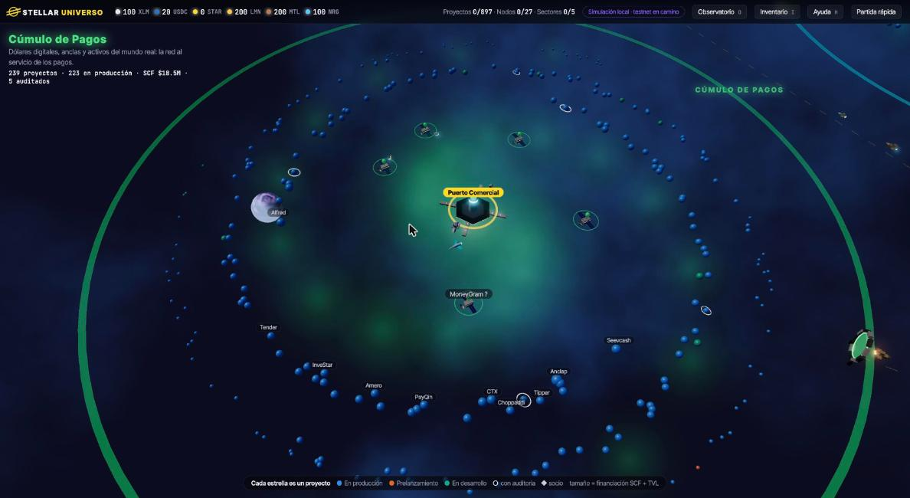 | **Cúmulo de Pagos** | USDC, MoneyGram, anclas y el Puerto Comercial | 239 proyectos · SCF $18,5M |
| 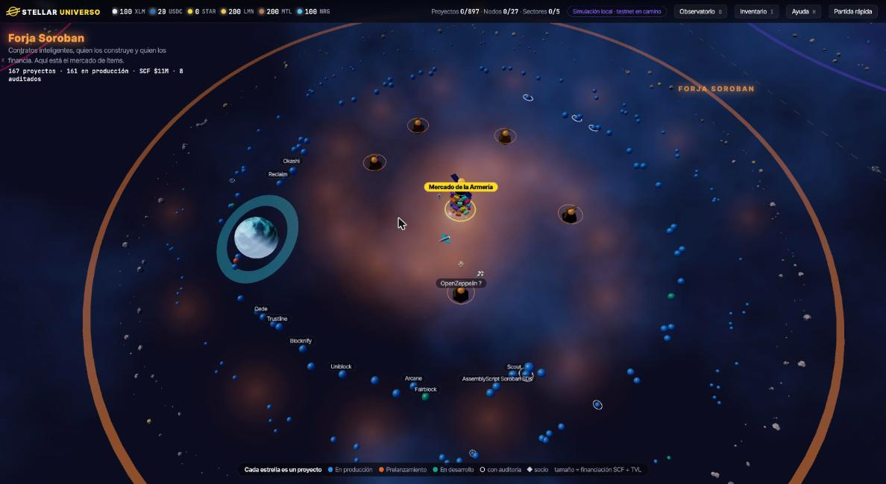 | **Forja Soroban** | SDKs, seguridad, la SDF, Stellar Quest y el Mercado de la Armería | 167 proyectos · SCF $11M · 8 auditados |
| 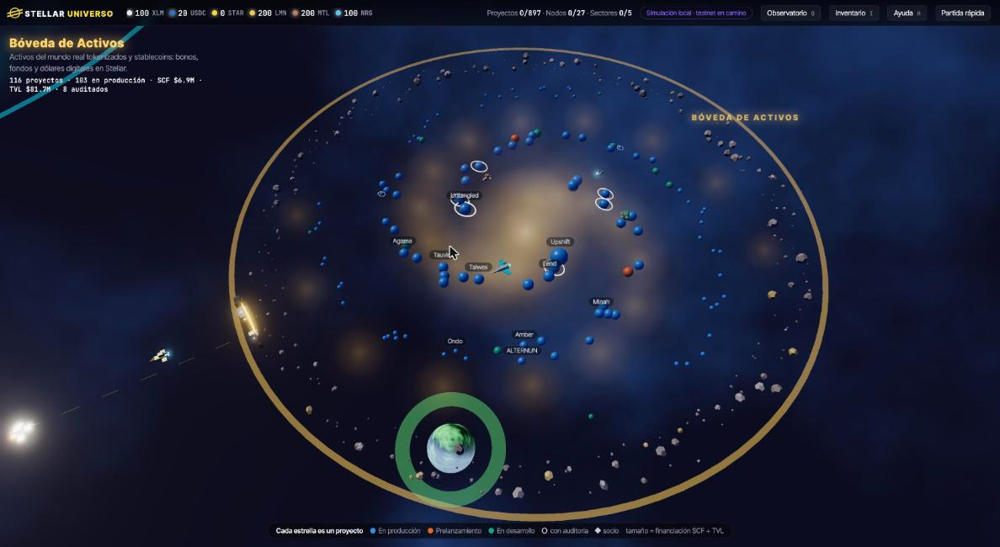 | **Bóveda de Activos** | Activos del mundo real tokenizados y stablecoins | 116 proyectos · SCF $6,9M · TVL $81,7M |
| 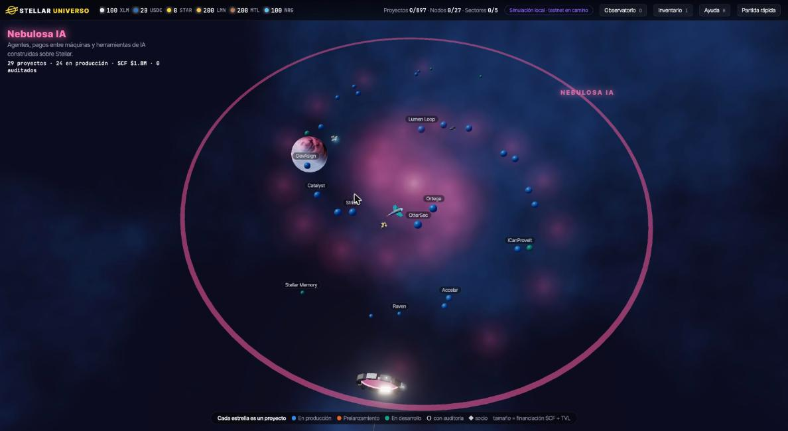 | **Nebulosa IA** | Agentes, pagos entre máquinas y herramientas de IA | 29 proyectos · SCF $1,8M |
| 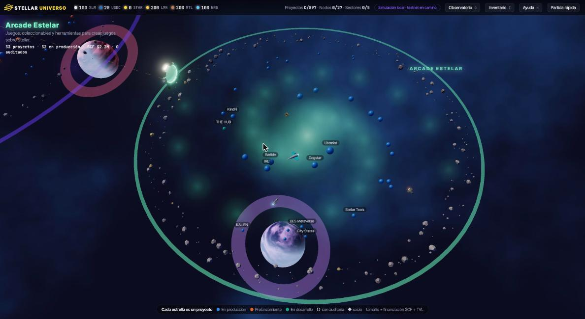 | **Arcade Estelar** | Juegos y coleccionables | 33 proyectos · SCF $2,2M |
| 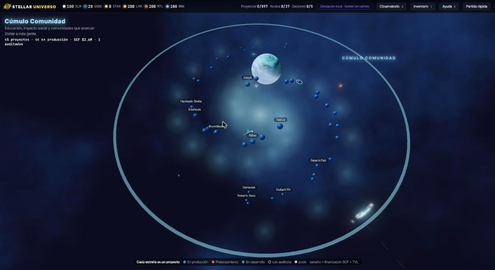 | **Cúmulo Comunidad** | Educación e impacto social | 45 proyectos · SCF $2,6M |
| 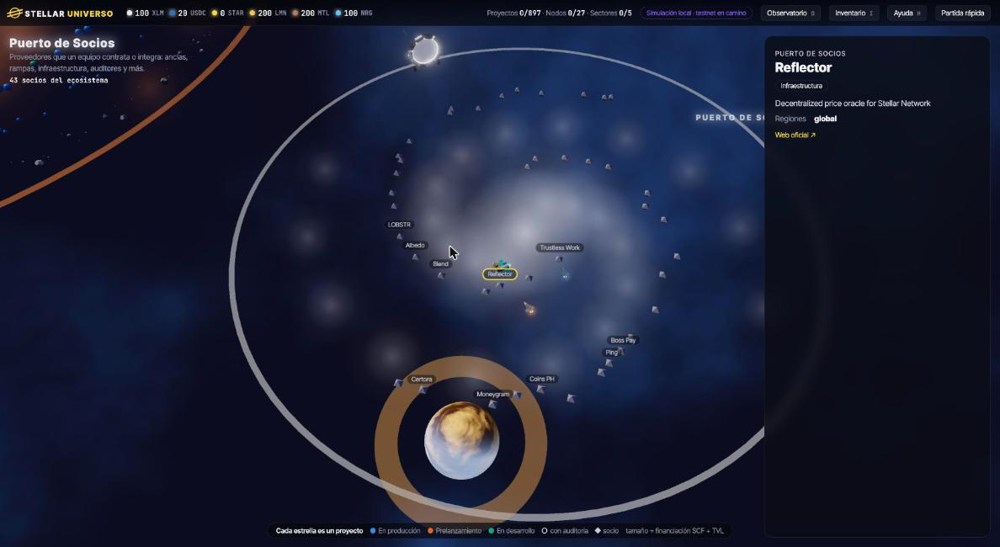 | **Puerto de Socios** | Proveedores que un equipo contrata o integra | 43 socios |
| 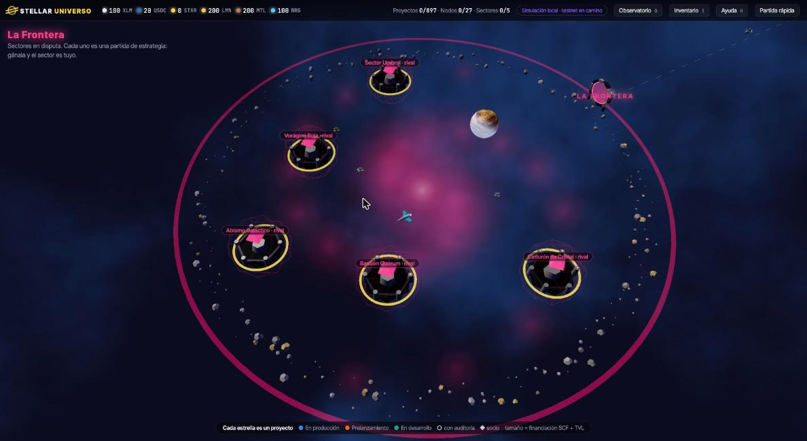 | **La Frontera** | Cinco sectores en disputa; cada uno es una partida RTS | 5 sectores |

### Dentro del juego

| | |
|---|---|
| 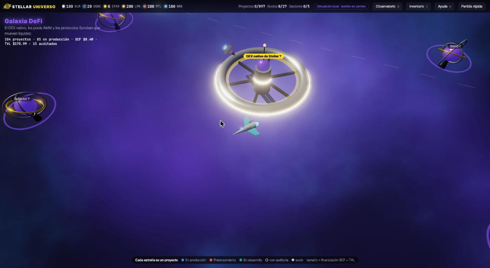 **Estación del DEX nativo.** Anillo habitable que gira, con tráfico de cargueros. | 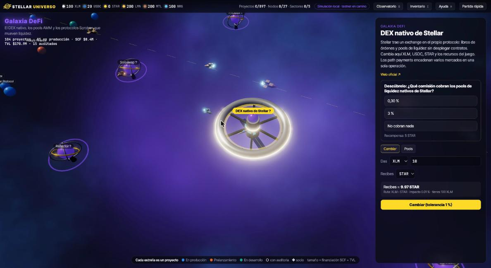 **Cambiar en el DEX.** Pools AMM con comisión del 0,30 % y path payments de hasta 3 saltos. |
| 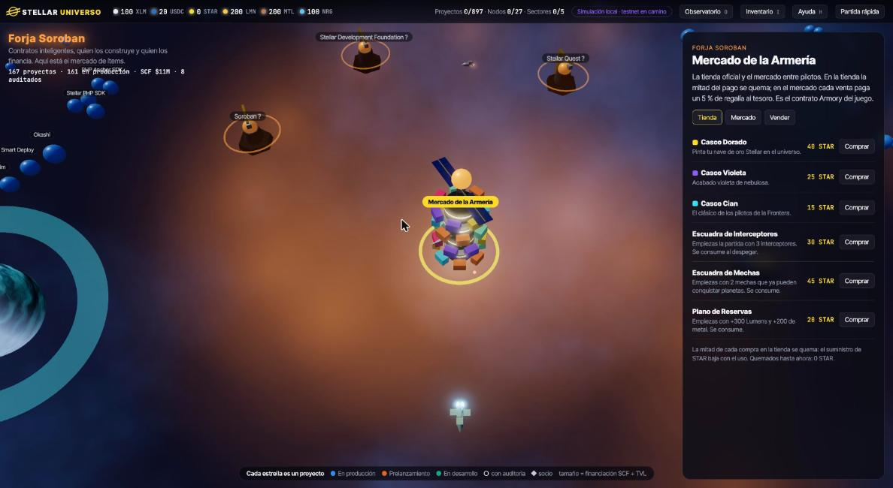 **Mercado de la Armería.** La tienda quema la mitad de cada pago; el mercado P2P cobra un 5 % de regalía. | 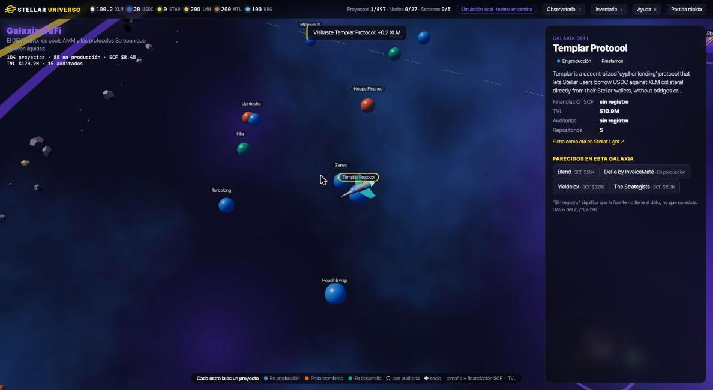 **Ficha de proyecto.** Estado, tipos, SCF, TVL, auditorías y proyectos parecidos. Visitarlo da 0,2 XLM. |
| 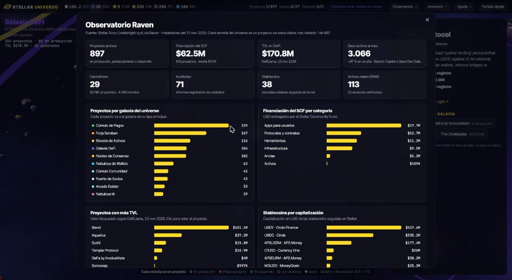 **Observatorio Raven (tecla O).** Indicadores y gráficos del ecosistema: SCF, TVL, stablecoins, RWA, auditorías, actividad y hackathons. | 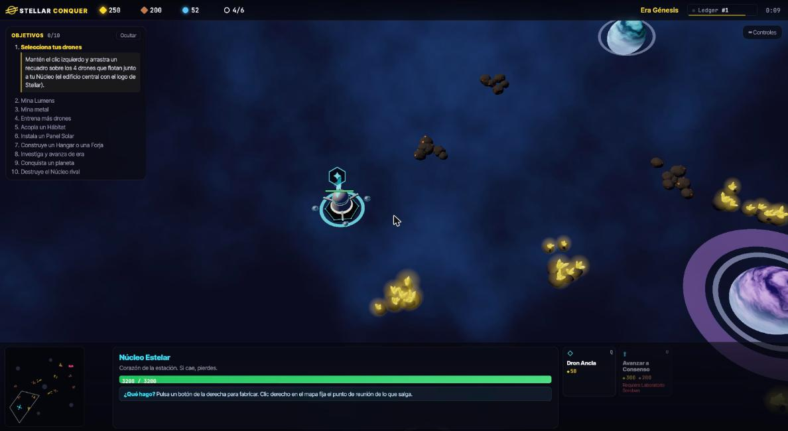 **Partida en la Frontera.** Estación modular, recolección, eras y una guía de objetivos. |

## Contratos desplegados en testnet

Tres contratos Soroban escritos en Rust (soroban-sdk 25), de 13 a 19 KB de WASM. Las direcciones están en
[`game/src/chain/deployment.testnet.json`](game/src/chain/deployment.testnet.json).

| Contrato | Para qué sirve | Dirección |
|---|---|---|
| **Armory** | Ítems, tienda oficial y mercado P2P con regalía | [`CBTEP7D3…3SVD`](https://stellar.expert/explorer/testnet/contract/CBTEP7D3PBXYIU5NR5MVWZ5QYYMWWJVN2CY4JPZNTS5Q4YIKNAOD3SVD) |
| **Conquest** | Resultados verificables, disputas y recompensas en STAR | [`CDLYRDS5…MH4F`](https://stellar.expert/explorer/testnet/contract/CDLYRDS54S4JORCXDG2WEI4WQM2UHJNTWNPAWRWRM7OOYKNOH3UOMH4F) |
| **Vault** | Sesiones de partida y liquidación de recursos | [`CDXT746J…WOR`](https://stellar.expert/explorer/testnet/contract/CDXT746JJMMTC2ILHGC7WB2QZLXPW7FUABWCUQOF665KW7BRRMWHPWOR) |

```
                       activos clásicos de Stellar (emisor bloqueado)
          ┌──────────┐   ┌──────────┬──────────┬──────────┐
          │   STAR   │   │   LMN    │   MTL    │   NRG    │◀──── DEX y pools AMM nativos
          │  (SAC)   │   │  (SAC)   │  (SAC)   │  (SAC)   │      path payments a XLM / USDC
          └──▲───▲───┘   └────▲─────┴────▲─────┴────▲─────┘
  transfer   │   │ burn+      │ mint / burn (admin = Vault)
  recompensa │   │ transfer   │
┌────────────┴┐ ┌┴──────────┐ ┌┴──────────────┐
│  Conquest   │ │  Armory   │◀┤     Vault     │
│ resultados  │ │ ítems,    │ │ sesiones y    │
│ + fondo     │ │ tienda,   │ │ liquidación   │
│ de STAR     │ │ mercado   │ │ de recursos   │
└──────▲──────┘ └───────────┘ └──────▲────────┘
       │      firma ed25519           │
       └─────────── Verificador ──────┘
               (re-simula seed + comandos)
```

Configuración del despliegue en testnet:
- **Conquest:** 50 STAR por victoria PvP y 10 contra la IA; presupuesto de 54.794 STAR al día, que se
  reduce a la mitad cada año; tope de 200 STAR por jugador y día; 5.000 STAR al día para partidas contra la
  IA; fianza de disputa de 100 STAR; ventana de disputa de **120 s**, reducida para probar más rápido (el
  script usa 600 s por defecto).
- **Vault:** hasta 500 recursos de sobrante por partida, 50.000 acuñados al día por recurso y 5
  liquidaciones diarias por jugador.
- **Armory:** regalía del 5 % en el mercado.

## Funciones y comprobantes

Probamos el ciclo completo con dos jugadores en testnet el 26 de noviembre de 2026. Cada comprobante
enlaza a la transacción en StellarExpert, y comprobamos en Horizon que todas terminaron con éxito. Las
lecturas se simulan y no crean transacción.

### Armory

| Función | Argumentos | Qué hace | Comprobante |
|---|---|---|---|
| `__constructor` | `config` | Crea el contrato: token STAR, tesoro y regalía | [bbad0ba0](https://stellar.expert/explorer/testnet/tx/bbad0ba01349acb65d72240c3d33a35eca1cc5b3ba3e9c28e941263901fb02d9) |
| `set_vault` | `vault` | Enlaza la bóveda, única que puede consumir ítems (admin) | [d8782837](https://stellar.expert/explorer/testnet/tx/d87828373f78000f8aa6a370c61ef72d881ee072bf663a9a382f3ef06ac3c92d) |
| `define_item` | `id, name, category, rarity, max_supply, price` | Añade un ítem al catálogo (admin) | [1](https://stellar.expert/explorer/testnet/tx/8e29efbf4b14e47afe7064ea368e9d6c0d82bddd5a0d73ddb62589b26e7989dc) · [2](https://stellar.expert/explorer/testnet/tx/0806ed104d48e4ecb6c9603a957869f14e625f536ea0498e7b30dea2c950cbb1) · [3](https://stellar.expert/explorer/testnet/tx/19932c36d58a37fb7c06d831f285d53f995de36ca7340f2ec534b6fbf38cc268) · [4](https://stellar.expert/explorer/testnet/tx/c822f1a0528a2182c424215de6db7a73f135cf0dcd17f9c8cc274d57de212430) · [101](https://stellar.expert/explorer/testnet/tx/818d18fe221123e8443211c8077b064b8cb7f9c5c1c61cb0e31c3c559945053a) · [102](https://stellar.expert/explorer/testnet/tx/cef2665feee717aacb38195ec58b86c6c8aa2b02b08da91ce3ead19679071cde) · [103](https://stellar.expert/explorer/testnet/tx/feb2f578fcc72aad099ec44a5e315372d021a3edaa736aa0ed21d5fc780642e2) · [111](https://stellar.expert/explorer/testnet/tx/a41df384c3cd432b75c271f645510358b8012f813584133b1ff486237659981e) · [112](https://stellar.expert/explorer/testnet/tx/623092deeb8b428fc90ea5850d7d8b09b3541c9f955143dd71fea703064b3e80) · [201](https://stellar.expert/explorer/testnet/tx/ffd7376277f28e87eb055b832c3ffacab1440fa1901d7218a334d9c6a8890369) · [202](https://stellar.expert/explorer/testnet/tx/d794d9b891cdcd4862c9792dbb9e556735ad3457ecd16bf8fb28270b46482688) |
| `mint` | `to, id, amount` | Acuña ítems para premios o eventos (admin) | [480460c7](https://stellar.expert/explorer/testnet/tx/480460c732d17bf0ad7141700093dab3a9aca32763567b85c72f9280c62c170d) |
| `buy` | `buyer, id, amount` | Compra en la tienda: quema la mitad y el resto va al tesoro | [2 escuadras](https://stellar.expert/explorer/testnet/tx/fc3a4444dcd5805269b47c1a1a97396973c8bcef5985c44adc0b5a5d51f2d9c8) · [casco](https://stellar.expert/explorer/testnet/tx/3cf98f3a30b2266e92cd87178c056aab8c9eb7124ea88b0f2bb8ffaa78d831df) · [mechas](https://stellar.expert/explorer/testnet/tx/5f1e26658f2123b6f5141ada2dac7a47c9c93df2c3cb8a7641d9536a4d0e9679) |
| `transfer` | `from, to, id, amount` | Envía un ítem a otro jugador | [e98131aa](https://stellar.expert/explorer/testnet/tx/e98131aae1b10e8b95a80d31c56aceca154b369bf177e11eae51b8daa30b29e2) |
| `consume` | `owner, id, amount` | Quema ítems equipados; solo la llama Vault al abrir una partida | [dentro de Vault.open](https://stellar.expert/explorer/testnet/tx/09ebf890403253d46412b1e93a384d6d1f4a2513cfff2fb28544eb9a3823ad48) |
| `list` | `seller, id, amount, price` | Publica un anuncio en el mercado P2P | [casco a 30 STAR](https://stellar.expert/explorer/testnet/tx/c1336cb9d809d192eb3c5de68d76cf73e49e77edb281e6063f9c07048b5e74c4) · [mechas a 70 STAR](https://stellar.expert/explorer/testnet/tx/0c815b117a81336f0e5e250765d1ea4dfaee7d2137f865b910caca6d82c7678a) |
| `buy_listing` | `buyer, listing, amount` | Compra un anuncio; 5 % de regalía al tesoro | [78722ddc](https://stellar.expert/explorer/testnet/tx/78722ddc0d9093aab05953529b07480438cbb36bc2fbf71756ea63109010d3ac) |
| `cancel` | `seller, listing` | Retira un anuncio y devuelve el ítem | [346f2f81](https://stellar.expert/explorer/testnet/tx/346f2f817e3ebf2f55f1148432c4458f4fdb8710bfe01b1b57465b6347a74c63) |
| `balance` | `owner, id` | Unidades de un ítem que tiene un jugador | _lectura_ |
| `item` | `id` | Ficha de un ítem del catálogo | _lectura_ |
| `listing` | `listing` | Datos de un anuncio | _lectura_ |
| `upgrade` | `wasm_hash` | Actualiza el código sin cambiar la dirección (admin) | _no probada en la red_ |

### Conquest

| Función | Argumentos | Qué hace | Comprobante |
|---|---|---|---|
| `__constructor` | `config` | Crea el contrato con recompensas, presupuestos, fianza y ventana | [a220d2b9](https://stellar.expert/explorer/testnet/tx/a220d2b9417cc3abcfe6da761757c6fda1fae94364812f8a0635232f94467606) |
| `report` | `result, signature` | Publica un resultado firmado por el verificador | [A: PvP](https://stellar.expert/explorer/testnet/tx/9daab232fd1ba9fbddfc441c589cb521ca799ccf2cb44468a6c77c79b77ee28a) · [B](https://stellar.expert/explorer/testnet/tx/85656625d95ae40cc6fdc14c54ffe948f5dcb76855a8e1a5e063908b8bc6db14) · [C: contra la IA](https://stellar.expert/explorer/testnet/tx/c07c81a4e1f1a5480dd3c56944df6bf5619dc07c08598c187d4608880169b3e8) |
| `dispute` | `challenger, match_id` | Impugna un resultado depositando la fianza | [B](https://stellar.expert/explorer/testnet/tx/a5a7bb439d5438344b4271f139f05621d7412455d41581a75913427ec04bf8a3) · [C](https://stellar.expert/explorer/testnet/tx/08f2515457541a970b43b1272d621a833fb81bfed9330841ff6e3e790e143ba4) |
| `resolve` | `match_id, valid` | Resuelve una disputa (admin): inválido devuelve la fianza | [B rechazada](https://stellar.expert/explorer/testnet/tx/e41b56f8a018cb8d0f7f625ad0187ce5dea64a74a92cbcf3132b09e02b1a5a9f) · [C válida](https://stellar.expert/explorer/testnet/tx/4c7ad458fb15864f4ba058276d91573666b4d5f73f4d369543fbd7cf569e188c) |
| `claim` | `match_id` | Cobra la recompensa al cerrar la ventana | [C: 10 STAR](https://stellar.expert/explorer/testnet/tx/f51eee5e95f3d9cb86ffa2c38907c11533e810025b196095f110bd8e886c1a2c) · [A: 50 STAR](https://stellar.expert/explorer/testnet/tx/e43d91ce51c60a230fad8c89f631314f31d0ec7b9d57e3e20f90283b2e676f12) |
| `quote` | `player, vs_ai` | Cuánto cobraría ahora un jugador | _lectura_ |
| `daily_budget` | — | Presupuesto de recompensas del día | _lectura_ |
| `get_match` | `match_id` | Estado de una partida registrada | _lectura_ |
| `stats` | `player` | Victorias, derrotas y STAR ganados | _lectura_ |
| `config` | — | Configuración del contrato | _lectura_ |
| `set_verifier` | `verifier` | Cambia la clave del verificador (admin) | [48638d81](https://stellar.expert/explorer/testnet/tx/48638d8198d01f2c583a045871b296ec91e60b2785eb8dddeb6bd4c83b857eba) |
| `set_admin` | `admin` | Cambia el administrador | _no probada en la red_ |
| `upgrade` | `wasm_hash` | Actualiza el código sin cambiar la dirección (admin) | _no probada en la red_ |

### Vault

| Función | Argumentos | Qué hace | Comprobante |
|---|---|---|---|
| `__constructor` | `config` | Crea el contrato con los recursos y sus topes | [9248460c](https://stellar.expert/explorer/testnet/tx/9248460c640dc91890e1e0d19bf9f450306b704bfb94ea38c897fc56cd74bcd7) |
| `session_id` | `player, seed` | Identificador de una partida | _lectura_ |
| `open` | `player, seed, ids, amounts` | Abre una partida y quema hasta 3 ítems equipados | [09ebf890](https://stellar.expert/explorer/testnet/tx/09ebf890403253d46412b1e93a384d6d1f4a2513cfff2fb28544eb9a3823ad48) |
| `deposit` | `player, session, resource, amount` | Quema recursos de la wallet y los mete en la partida | [b523a230](https://stellar.expert/explorer/testnet/tx/b523a230c59bb366271c79cbf7f78d6e33a36f757c21c388750d8e7ce838d008) |
| `sell` | `player, session, resource, amount` | Registra una venta hecha en la partida | [3cae60d0](https://stellar.expert/explorer/testnet/tx/3cae60d086d7bac31aa007347304d7475134e2d555710d1cfa884e750fa20632) |
| `settle` | `settlement, signature` | Liquida con la firma del verificador y acuña lo vendido más el sobrante | [94323d34](https://stellar.expert/explorer/testnet/tx/94323d347efe421c817f657a04287d02deae6420e88ca2b27d9ebc62216ed463) |
| `get_session` | `session` | Estado de una partida | _lectura_ |
| `config` | — | Configuración de la bóveda | _lectura_ |
| `set_verifier` | `verifier` | Cambia la clave del verificador (admin) | _no probada en la red_ |
| `upgrade` | `wasm_hash` | Actualiza el código sin cambiar la dirección (admin) | _no probada en la red_ |

### DEX nativo

No es un contrato propio: el jugador compra los recursos con XLM en el libro de órdenes nativo de Stellar.

| Operación | Qué probamos | Comprobante |
|---|---|---|
| `manage-buy-offer` | 100 LMN por 1 XLM | [a9b5508f](https://stellar.expert/explorer/testnet/tx/a9b5508f286ac3f82e1bb984d539272a04ced55c249b3e3e934a0d27d761a65e) |
| `manage-buy-offer` | 100 MTL por 1 XLM | [8948b5e7](https://stellar.expert/explorer/testnet/tx/8948b5e794edd6028abd5de9f880ce6a9c3c7e7fbbac7954715b900a6aee766e) |

Para repetir la prueba, firma como verificador `(dirección del contrato, struct).to_xdr()` con ed25519 y
llama a cada función con la CLI de Stellar:

```bash
stellar contract invoke --id <CONQUEST> --source jugador --network testnet -- \
  report --result '{"match_id":"…","winner":"G…","loser":"G…","seed":42,"log_hash":"…","state_hash":"…","ledgers":420}' \
  --signature <firma ed25519 en hex>
```

## Assets

### Activos on-chain

Los cuatro son activos clásicos de Stellar expuestos con su Stellar Asset Contract (SAC). El emisor
[`GDEGPHV3…I2CC`](https://stellar.expert/explorer/testnet/account/GDEGPHV32I4T7AYDL4SQPNJK2XELGPMTSZ7PXBMAXGIYE3WZTWG7I2CC)
está bloqueado (`master-weight 0`), así que nadie puede emitir más STAR.

| Activo | Qué es | Suministro | Quién acuña | SAC en testnet |
|---|---|---|---|---|
| **STAR** | Moneda del juego: recompensas, tienda y mercado | 100 M fijos: 40 M al fondo de Conquest y 60 M al tesoro | Nadie (emisor bloqueado) | [`CAG6VJ3L…PY2N`](https://stellar.expert/explorer/testnet/contract/CAG6VJ3LZIPYEXYNGD5SYV3FPP4IHHU6HUWQTAYAFMVW7U7D7XWPPY2N) |
| **LMN** | Lumen dorado de los asteroides de cristal (no es XLM) | Lo que se gana jugando | Solo Vault, al liquidar | [`CA6AOE5T…VDZQ`](https://stellar.expert/explorer/testnet/contract/CA6AOE5TKWSWNWCUNK2XFQHOX4QZQQVAVZAMPWNJCAJQ5H6V4OQJVDZQ) |
| **MTL** | Metal de los asteroides rocosos | Igual | Solo Vault | [`CD2I5LNY…BGUF`](https://stellar.expert/explorer/testnet/contract/CD2I5LNYRKQDJZULV3RC2QBCBUPM7MRHC4APJ4CONUTXSNCAHDHTBGUF) |
| **NRG** | Energía de los paneles solares | Igual | Solo Vault | [`CCKZMTUK…YFXZ`](https://stellar.expert/explorer/testnet/contract/CCKZMTUKMHSM5PXFJWFEGZ7SNGYRVJRBACJVMFPJNJDPDUUZ6LSKYFXZ) |

**Cómo circula el valor:**
- Comprar en la tienda quema la mitad del pago, así que el suministro de STAR baja con el uso.
- Los recursos que metes en una partida se queman.
- Al liquidar se acuñan solo los recursos vendidos más un sobrante con tope, y el DEX nativo les da precio
  frente a XLM y USDC. El despliegue siembra ofertas de 500.000 de cada recurso a 0,01 XLM.

### Catálogo de ítems (Armory)

Los ítems son semifungibles: cada uno tiene un `id` y cada jugador un saldo de unidades. Los que se equipan
para una partida se queman al despegar, a través de `Vault.open`.

| id | Ítem | Categoría | Rareza | Suministro máximo | Precio |
|---|---|---|---|---|---|
| 1 | Casco Aurora | Skin | Común | Ilimitado | 25 STAR |
| 2 | Casco Nebulosa | Skin | Rara | 5.000 | 80 STAR |
| 3 | Casco Consenso Dorado | Skin | Épica | 500 | 250 STAR |
| 4 | Casco Horizonte de Eventos | Skin | Legendaria | 50 | 900 STAR |
| 101 | Escuadra de interceptores | Escuadrón | Común | Ilimitado | 40 STAR |
| 102 | Ala de fragatas | Escuadrón | Rara | 5.000 | 120 STAR |
| 103 | Pareja de mechas | Escuadrón | Común | Ilimitado | 60 STAR |
| 111 | Plano: torreta de plasma | Plano | Común | Ilimitado | 60 STAR |
| 112 | Plano: faro de consenso | Plano | Épica | 500 | 400 STAR |
| 201 | Facción Anclas de Soroban | Facción | Rara | 1.000 | 300 STAR |
| 202 | Facción Validadores | Facción | Épica | 500 | 450 STAR |

La versión del navegador usa por ahora un catálogo reducido de 6 ítems (tres cascos, dos escuadras y un
plano), con las mismas reglas.

### Assets visuales

No hay modelos ni texturas externos: todo se genera en código con primitivas de Three.js, así que el juego
pesa unos 215 KB comprimido y los datos del ecosistema se cargan aparte (67 KB).

**Universo** ([`game/src/world/spacecraft.ts`](game/src/world/spacecraft.ts))

| Asset | Dónde aparece | Cómo es |
|---|---|---|
| Estación de anillo | DEX nativo | Anillo habitable giratorio con radios, hub con franja de ventanas, alas solares y baliza |
| Bazar orbital | Mercado de la Armería | Espina con cuatro módulos y anillos de contenedores de colores |
| Puerto de carga | Puerto Comercial | Plataforma hexagonal, cuatro brazos de atraque con luces de pista y fragatas amarradas |
| Radiotelescopio | Observatorio Raven | Antena principal que barre el cielo y tres antenas menores |
| Ciudadela | Sectores de la Frontera | Muralla hexagonal, torres con luces y escudo del color del dueño |
| Satélites | Nodos de información | Validador (Núcleo), bóveda (Wallets), reactor (DeFi), forja (Soroban) y repetidor (resto) |
| Puerta de salto | Entrada de cada galaxia | Anillo segmentado con portal pulsante |
| Tráfico | Rutas y galaxias | Cargueros y lanzaderas instanciados con toberas encendidas |
| Astros del atlas | 897 proyectos y 43 socios | Esferas iluminadas con halo titilante, anillo de auditoría y diamantes para los socios |
| Ambiente | Todo el mapa | Nebulosa procedural con shader, planetas con shader, cinturones de asteroides y bloom |

**Partida RTS** ([`game/src/render/models.ts`](game/src/render/models.ts))

| Módulos de la estación | Unidades |
|---|---|
| **Núcleo Estelar**: corazón de la estación; si cae, pierdes | **Dron Ancla**: recolecta y ensambla módulos |
| **Hábitat**: +8 de población | **Interceptor Lumen**: caza rápido y barato |
| **Panel Solar**: energía continua | **Mecha Centinela**: derriba módulos y conquista planetas |
| **Ancla**: puesto remoto y nuevo punto de acople | **Fragata Horizon**: artillería de plasma de largo alcance |
| **Hangar**: construye naves de combate | **Titán Soroban**: robot pesado que demuele estaciones |
| **Forja de Robots**: ensambla robots | **Acorazado Consenso**: nave insignia |
| **Laboratorio Soroban**: avanza de era, +20 % de recolección | |
| **Torreta Láser**: defensa automática | |
| **Faro de Consenso**: maravilla; si resiste 30 ledgers, ganas | |

**Datos** ([`game/src/world/data/raven.json`](game/src/world/data/raven.json)): instantánea de la API
pública de [Stellar Scout](https://stellarlight.xyz) (licencia MIT) con proyectos, financiación del SCF, TVL
(DefiLlama), auditorías, stablecoins, RWA, actividad de desarrollo, hackathons y socios.

## Cómo jugar en local

```bash
cd game
pnpm install
pnpm dev          # http://localhost:5174
pnpm test         # pruebas de la simulación, la economía y el atlas
pnpm snapshot     # refresca los datos del ecosistema
```

Controles del universo: **WASD** o clic para volar · **O** Observatorio · **I** Inventario · **H** Ayuda.

## Contratos

```bash
cd contracts
cargo test                       # 18 pruebas
stellar contract build           # WASM optimizado
DISPUTE_WINDOW=600 ../infra/deploy.sh   # despliega todo en testnet
```

El script crea las identidades, emite los activos y sus SAC, despliega los tres contratos, carga el
catálogo, reparte STAR, siembra el DEX, cede la emisión de recursos a Vault y bloquea el emisor. Más
detalles en [docs/ECOSISTEMA.md](docs/ECOSISTEMA.md).

## Estructura

```
game/
  src/world/     Universo: economía, mapa, atlas de Raven, infraestructura espacial, HUD y Observatorio
  src/sim/       simulación determinista de la partida (sin Three.js)
  src/render/    render 3D procedural con Three.js
  src/ui/        HUD, entrada y menús de la partida
  src/chain/     direcciones de los despliegues
  scripts/       instantánea del ecosistema (pnpm snapshot)
  test/          pruebas
contracts/       contratos Soroban en Rust: conquest, armory, vault
infra/           despliegue con la CLI de Stellar
docs/            documentación del ecosistema y capturas
```

## Próximos pasos

- Conectar el juego a testnet con Freighter y passkeys: comprar, abrir partida y cobrar firmando en la wallet.
- Servicio verificador que vuelva a simular las partidas y firme los resultados.
- Auditoría de los contratos antes de mainnet.
